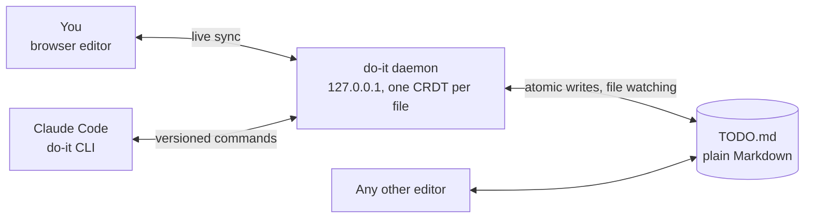

# claude-do-it

**A Markdown todo that you and Claude edit at the same time.**

You type in a browser editor. Claude reads the list, plans each task, hands it
to worker agents, and writes status, questions, and results back under the line
it belongs to. Your keystrokes, the agents' changes, and edits made to the file
on disk all merge instead of overwriting each other: every open file is one
[Loro](https://loro.dev) CRDT held by a small daemon on your machine. The file
itself stays plain Markdown, so any other editor still works on it.



## What's inside

- **The `do-it` CLI.** Versioned commands agents use to read and change a
  todo. Every change names the version it was made against, so a stale edit is
  refused with a diff instead of clobbering someone else's work.
- **The daemon.** One per user on `127.0.0.1`. It holds the open documents,
  watches their files, merges outside edits, and serves the editor. It starts
  on demand and stops after 30 idle minutes.
- **The browser editor.** Built with Foldkit and CodeMirror 6. It keeps the
  todo as plain Markdown while showing a live PlainTasks preview with markers,
  tags, actions, stamps, and a command palette. Task lines always stay
  rendered: markers show as ☐ ✔ ✘ and links as their text, with a popover to
  edit them.
- **The `/do-it` skill for Claude Code.** It turns a session into a conductor
  that sizes, plans, and delivers every task through worker agents and one
  shared tester.

## Install

Needs [Bun](https://bun.sh) 1.3 or newer on macOS or Linux.

```bash
bun add -g claude-do-it        # or: npm install -g claude-do-it (Bun still runs it)
do-it skill install            # the /do-it skill, copied into ~/.claude/skills/do-it
do-it --help
```

Run `do-it skill install` again after upgrading to refresh the skill. It never
replaces a skill directory it did not create unless you pass `--force`.
`do-it --skill` prints the skill, and `do-it skill path` shows where the
package keeps it. To try it without installing, use `bunx claude-do-it open TODO.md`.

The command is `do-it`, not `do`: `do` is a reserved word in bash and zsh.

### From source

```bash
git clone https://github.com/DomiR/claude-do-it ~/Developer/claude-do-it
cd ~/Developer/claude-do-it
bun install
bun run build:web                                          # the editor the daemon serves
mkdir -p ~/.local/bin
ln -sf "$PWD/packages/cli/src/bin.ts" ~/.local/bin/do-it   # any directory on PATH works
ln -s "$PWD/skill" ~/.claude/skills/do-it                  # the skill, always current with the checkout
```

## Use it from Claude Code

```
/do-it            # TODO.md in the current directory, created when missing
/do-it PLAN.md
```

The browser opens on the todo (inside Sheprd, in a split beside the
conversation). Add one task per line. The session is a conductor: it marks each
task `@started` as soon as it picks it up, sizes it, and delegates the rest
(planning, building, the single test queue, review, and answers to questions)
to agents, watching them instead of doing the work itself. Each task gets one
status line under it, plus any question it needs you to answer (answer by
writing under the question). Delivered tasks are checked off with `@done`,
their branch, and their test result. An optional messenger agent can write
those lines for the conductor.

PlainTasks tags steer the work: `@critical`, `@high`, and `@today` go first,
`@low` last, and `@due(date)` reaches the worker as a deadline. Agents never
change your tags; `@started`, `@done`, and `@cancelled` come only from the
`do-it todo` commands.
The skill checks where it runs and starts workers there:

| Where | Workers |
| --- | --- |
| Herdr (`HERDR_ENV=1`) | Claude architects in Herdr worktrees and tabs, with Codex lanes |
| [Orca](https://www.onorca.dev) | one Orca worktree per task, with Claude in its first terminal (`orca worktree create --agent claude`) |
| [T3 Code](https://github.com/pingdotgg/t3code), with its `t3` CLI | one T3 Code thread per task, in its own worktree (`t3 thread start --worktree`) |
| Any other terminal | Claude Code subagents in worktrees, which need nothing beyond Claude Code |

Set `DO_IT_BROWSER` to the command that should open links, or to `true` to
open nothing.

## Use the CLI

```bash
do-it open TODO.md                    # start or reuse the daemon, open the browser, return
do-it read TODO.md                    # "Version: 7" then the text
do-it todo list TODO.md
do-it todo add TODO.md --version 7 --section tasks "Write tests"
do-it todo start TODO.md --version 8 --section tasks 3
do-it todo check TODO.md --version 9 3
do-it edit TODO.md --version 10 --old "ship friday" --new "ship monday"
do-it append TODO.md --version 11 --section notes -- "- found: flaky CI"
do-it diff TODO.md --since 9 --wait 300
do-it watch TODO.md --todos           # or --settle 25 for one line per pause
do-it status
do-it stop
```

### How versions work

Every reply starts with the document's version, and every change, by anyone,
takes the next one. A change names the version it was made against. When the
document has moved on, nothing is applied and the reply is the latest version
plus a diff (exit 1). With `--section ID` a stale version still applies while
that section is unchanged.

A resumed watch that missed history prints
`Missed changes, now at version N: run do-it read`. Use `--quiet` to skip the
initial `Watching PATH at version N` line.

`--json` works on every command, and `--as NAME` (or `DO_IT_AGENT`) names the
agent.

| Exit code | Meaning |
| --- | --- |
| 0 | Done |
| 1 | Refused, or version mismatch |
| 2 | Invalid arguments |
| 3 | The daemon is not running and could not start |
| 4 | Nothing changed yet |
| 9 | The document was deleted |

## Editor keys

| Action | macOS | Linux and Windows |
| --- | --- | --- |
| New task | `Cmd-Enter` or `Cmd-I` | `Ctrl-Enter` or `Ctrl-I` |
| Toggle done | `Cmd-D` or `Cmd-Shift-Enter` | `Ctrl-D` or `Ctrl-Shift-Enter` |
| Toggle cancelled | `Ctrl-C` or `Cmd-Alt-Enter` | `Alt-C` or `Ctrl-Alt-Enter` |
| Archive resolved tasks | `Cmd-Shift-A` or `Cmd-Alt-A` | `Ctrl-Shift-A` or `Ctrl-Alt-A` |
| Move up | `Cmd-Ctrl-Up` or `Alt-Up` | `Ctrl-Shift-Up` or `Alt-Up` |
| Move down | `Cmd-Ctrl-Down` or `Alt-Down` | `Ctrl-Shift-Down` or `Alt-Down` |
| Continue task | `Enter` | `Enter` |
| Expand a PlainTasks tag, or indent | `Tab` | `Tab` |
| Outdent | `Shift-Tab` or `Cmd-[` | `Shift-Tab` or `Ctrl-[` |
| Open link | `Cmd-Shift-U` or `Alt-Enter` | `Alt-Enter` |
| Edit link (or click a link on a task line) | `Cmd-K` | `Ctrl-K` |
| Go to project | `Cmd-P` | `Ctrl-P` |
| Command palette | `Cmd-Shift-P` or `F1` | `Ctrl-Shift-P` or `F1` |
| Find | `Cmd-F` | `Ctrl-F` |
| Keyboard shortcuts | `Cmd-/` | `Ctrl-/` |

Escape then Tab leaves the editor and returns focus to the page.

## The daemon

There is one daemon per user. Any command starts it on demand; `do-it stop` or
30 idle minutes stop it. State lives in `~/.do-it` (`DO_IT_HOME`): the runtime
record, a per user token (mode 0600), the log, and the last version of each
file, so version numbers survive restarts. It listens on `127.0.0.1:47100`
(`DO_IT_PORT`) and only answers requests that carry the token or the browser
cookie the `open` link sets.

## How it's built

| Package | What it does |
| --- | --- |
| [`protocol`](packages/protocol) | RPC schema, errors, and formatting shared by every side |
| [`doc`](packages/doc) | The CRDT document, Markdown sections and tasks, diffs, and atomic file I/O |
| [`server`](packages/server) | The daemon: HTTP and RPC, auth, the document registry, file watching |
| [`client`](packages/client) | Finds, starts, and stops the daemon, plus a typed RPC client |
| [`cli`](packages/cli) | The `do-it` command |
| [`web`](packages/web) | The browser editor |
| [`tui`](packages/tui) | A terminal editor (not built yet) |

Everything runs on [Effect](https://effect.website) 4. File system, paths,
child processes, standard I/O, crypto, and configuration all go through Effect
platform services, and Bun provides the implementations. The design notes are
in [docs/plan.md](docs/plan.md) and [docs/design.md](docs/design.md).

## Develop

```bash
bun run test                          # unit, daemon, and end to end tests
bun run typecheck
bun run build:web
bun run build:npm                     # the npm package, in dist/npm
bun --cwd packages/web run dev        # editor with a proxy to the daemon on 47100
```

## Acknowledgements

The editor's notebook colours, PlainTasks markers, tag completions, stamps, and
tag colours are adapted from [PlainTasks](https://github.com/aziz/PlainTasks)
(MIT). See [NOTICE](NOTICE).

## License

[MIT](LICENSE)
